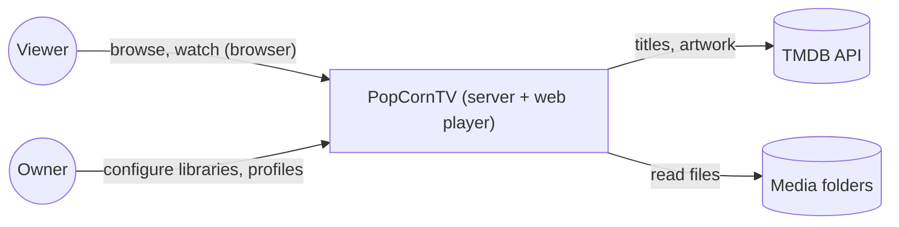

# Architecture — PopCornTV

Docs-as-code, organised by zoom level (C4) with UML 2.5 diagrams in Mermaid and MADR
decision records. The conception is the source of truth; code conforms to it.

## Adaptive wishlist study (#307)

Partly replaced on 2026-11-24 by the [on-demand retrieval](specs/on-demand-retrieval.md) conception (#434).

Draft, not accepted or implemented: [specification](specs/adaptive-wishlist-lifecycle.md),
[analysis use cases](diagrams/adaptive-wishlist/01-use-case.md),
[lifecycle](diagrams/adaptive-wishlist/05-state-preparation.md),
[traceability](traceability-matrix.md), [glossary](glossary.md).
The proposed method is risk-first UP elaboration ([ADR-0033](decisions/0033-elaborate-adaptive-playback-risks-before-construction.md)),
with backend feasibility #308 before detailed construction. The [#308 experiment study](specs/adaptive-wishlist-feasibility.md) compares candidates and defines evidence required before adoption. Audience: owner, household viewers
and implementer. Goals: private persistent wishes, daily discovery, bounded preparation and
honest ready-to-watch notices. API/schema/classes and deployment decisions await the spike.
Existing context below describes current main behavior, not the proposed recovery service.
The Seerr #128 design/runtime commits remain on a separate local branch; integration must
preserve its ADR-0032, UC31 and requirement IDs.

## Context (C4 level 1)



## Containers (C4 level 2)

| Container         | Technology                   | Responsibility                                          |
| ----------------- | ---------------------------- | ------------------------------------------------------- |
| `apps/web`        | React 19, Vite, hls.js       | Catalog browsing, player, profiles UI                   |
| `apps/server`     | Fastify 5, Drizzle, SQLite   | API, library scan, metadata, playback decisions, FFmpeg |
| `packages/shared` | TypeScript                   | Contracts shared by both                                |
| FFmpeg            | external process             | Probe files, transcode to HLS                           |
| SQLite            | file under `DATABASE_PATH`   | Libraries, media, profiles, watch progress              |

## Layout

```
docs/architecture/
  README.md                 # this overview
  decisions/                # ADRs (MADR) — NNNN-kebab-title.md
  diagrams/<feature>/       # UML per feature: 01-use-case … 06-data-flow
  specs/                    # textual use-case specifications (Cockburn)
  qa/                       # QA pass evidence per issue
```

## Features

| Feature    | Diagrams                                | Status  |
| ---------- | --------------------------------------- | ------- |
| `adaptive-wishlist` | [spec](specs/adaptive-wishlist-lifecycle.md), [diagrams](diagrams/adaptive-wishlist) | partly replaced by `on-demand-retrieval` (#434); recovery contract (ADR-0034) kept |
| `on-demand-retrieval` | [requirements](../requirements/08-on-demand-retrieval.md), [spec](specs/on-demand-retrieval.md), [diagrams](diagrams/on-demand-retrieval) | conception accepted (#434); slice 1 (films) next |
| `local-discovery` | [spec](specs/local-discovery-topology.md), [diagrams](diagrams/local-discovery) | local implementation (#327): empty services, no source configured; merge and exact-head qualification tracked in PR #351 |
| `playback` | [diagrams/playback](diagrams/playback)  | design  |
| `redesign` | [inventory](specs/redesign-screen-inventory.md), [information architecture](specs/redesign-information-architecture.md), [diagrams](diagrams/redesign) | design (epic #401, #396) |

## Decisions

| ADR                                        | Title                          | Status   |
| ------------------------------------------ | ------------------------------ | -------- |
| [0001](decisions/0001-all-typescript-stack.md) | All-TypeScript pnpm monorepo | accepted |
| [0002](decisions/0002-file-naming-parser.md) | File-naming parser: own regex parser | accepted |
| [0033](decisions/0033-elaborate-adaptive-playback-risks-before-construction.md) | Elaborate adaptive playback risks before construction | proposed |
| [0034](decisions/0034-verify-pieces-before-progressive-playback.md) | Verify pieces before progressive playback | accepted — bounded construction, source diversity retained |
| [0036](decisions/0036-local-discovery-topology-and-gate-scope.md) | Local discovery topology and gate scope | accepted |
| [0037](decisions/0037-penpot-design-tool-and-token-direction.md) | Penpot as the design tool, `tokens.css` as the token source | accepted |
| [0040](decisions/0040-play-local-trailers-and-hand-off-remote-ones.md) | Play local trailers, hand remote ones off to a personal device | accepted |
| [0041](decisions/0041-give-views-and-titles-their-own-path.md) | Give views and titles their own path | accepted |
| [0043](decisions/0043-start-playback-from-a-sheet-prefetch.md) | Start playback from a sheet prefetch (revises ADR-0034) | accepted |
| [0044](decisions/0044-size-the-start-buffer-and-cap-the-cache.md) | Size the start buffer from speed and bitrate, cap the cache below the free space | accepted |
| [0045](decisions/0045-delete-after-48-hours-and-keep-a-favourite-third.md) | Delete 48 h after the last playback, keep the first third of a favourite | accepted |
| [0046](decisions/0046-pick-the-fastest-conforming-source.md) | Pick the fastest conforming source, play a degraded one only by choice | accepted |
| [0047](decisions/0047-notify-through-bell-push-and-e-mail.md) | Notify through the bell, Web Push and e-mail, chosen per profile | accepted |

## Specifications and QA

- `specs/<feature>.md` — textual Cockburn use-case specs ([library-scan](specs/library-scan.md)).
- `qa/<date>-issue-<n>-<slug>/` — QA pass outputs kept as merge evidence.

- [Issue 308 recovery and generation evidence](qa/2026-11-13-issue-308-recovery.md) — slow/full-file
  fallback, controlled partial restart, simulated POSIX rename; bounded construction accepted; production integration pending.

- [Issue 308 accepted research conclusion](qa/2026-11-13-issue-308-conclusion.md) — accepted decision, runtime boundaries and standalone hash-reader evidence.
