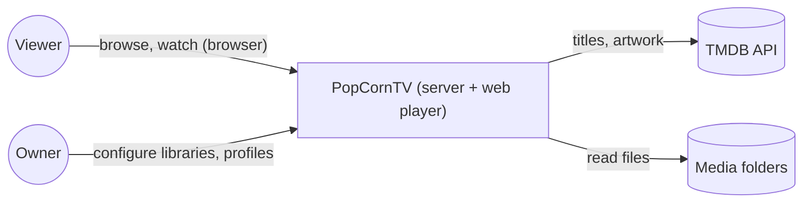

# Architecture — PopCornTV

Docs-as-code, organised by zoom level (C4) with UML 2.5 diagrams in Mermaid and MADR
decision records. The conception is the source of truth; code conforms to it.

## Adaptive wishlist study (#307)

Draft, not accepted or implemented: [specification](specs/adaptive-wishlist-lifecycle.md),
[analysis use cases](diagrams/adaptive-wishlist/01-use-case.md),
[lifecycle](diagrams/adaptive-wishlist/05-state-preparation.md),
[traceability](traceability-matrix.md), [glossary](glossary.md).
The proposed method is risk-first UP elaboration ([ADR-0033](decisions/0033-elaborate-adaptive-playback-risks-before-construction.md)),
with backend feasibility #308 before detailed construction. The [#308 experiment study](specs/adaptive-wishlist-feasibility.md) compares candidates and defines evidence required before adoption. Audience: owner, household viewers
and implementer. Goals: private persistent wishes, daily discovery, bounded preparation and
honest ready-to-watch notices. API/schema/classes and deployment decisions await the spike.
Existing context below describes current main behavior, not the proposed recovery service.
The Seerr #128 design/runtime commits remain on a separate local branch; integration must
preserve its ADR-0032, UC31 and requirement IDs.

## Context (C4 level 1)



## Containers (C4 level 2)

| Container         | Technology                   | Responsibility                                          |
| ----------------- | ---------------------------- | ------------------------------------------------------- |
| `apps/web`        | React 19, Vite, hls.js       | Catalog browsing, player, profiles UI                   |
| `apps/server`     | Fastify 5, Drizzle, SQLite   | API, library scan, metadata, playback decisions, FFmpeg |
| `packages/shared` | TypeScript                   | Contracts shared by both                                |
| FFmpeg            | external process             | Probe files, transcode to HLS                           |
| SQLite            | file under `DATABASE_PATH`   | Libraries, media, profiles, watch progress              |

## Layout

```
docs/architecture/
  README.md                 # this overview
  decisions/                # ADRs (MADR) — NNNN-kebab-title.md
  diagrams/<feature>/       # UML per feature: 01-use-case … 06-data-flow
  specs/                    # textual use-case specifications (Cockburn)
  qa/                       # QA pass evidence per issue
```

## Features

| Feature    | Diagrams                                | Status  |
| ---------- | --------------------------------------- | ------- |
| `adaptive-wishlist` | [spec](specs/adaptive-wishlist-lifecycle.md), [diagrams](diagrams/adaptive-wishlist) | lifecycle documented; recovery contract accepted; runtime implementation pending |
| `playback` | [diagrams/playback](diagrams/playback)  | design  |

## Decisions

| ADR                                        | Title                          | Status   |
| ------------------------------------------ | ------------------------------ | -------- |
| [0001](decisions/0001-all-typescript-stack.md) | All-TypeScript pnpm monorepo | accepted |
| [0002](decisions/0002-file-naming-parser.md) | File-naming parser: own regex parser | accepted |
| [0033](decisions/0033-elaborate-adaptive-playback-risks-before-construction.md) | Elaborate adaptive playback risks before construction | proposed |
| [0034](decisions/0034-verify-pieces-before-progressive-playback.md) | Verify pieces before progressive playback | accepted — bounded construction, source diversity retained |

## Specifications and QA

- `specs/<feature>.md` — textual Cockburn use-case specs ([library-scan](specs/library-scan.md)).
- `qa/<date>-issue-<n>-<slug>/` — QA pass outputs kept as merge evidence.

- [Issue 308 recovery and generation evidence](qa/2026-11-13-issue-308-recovery.md) — slow/full-file
  fallback, controlled partial restart, simulated POSIX rename; bounded construction accepted; production integration pending.

- [Issue 308 accepted research conclusion](qa/2026-11-13-issue-308-conclusion.md) — accepted decision, runtime boundaries and standalone hash-reader evidence.
