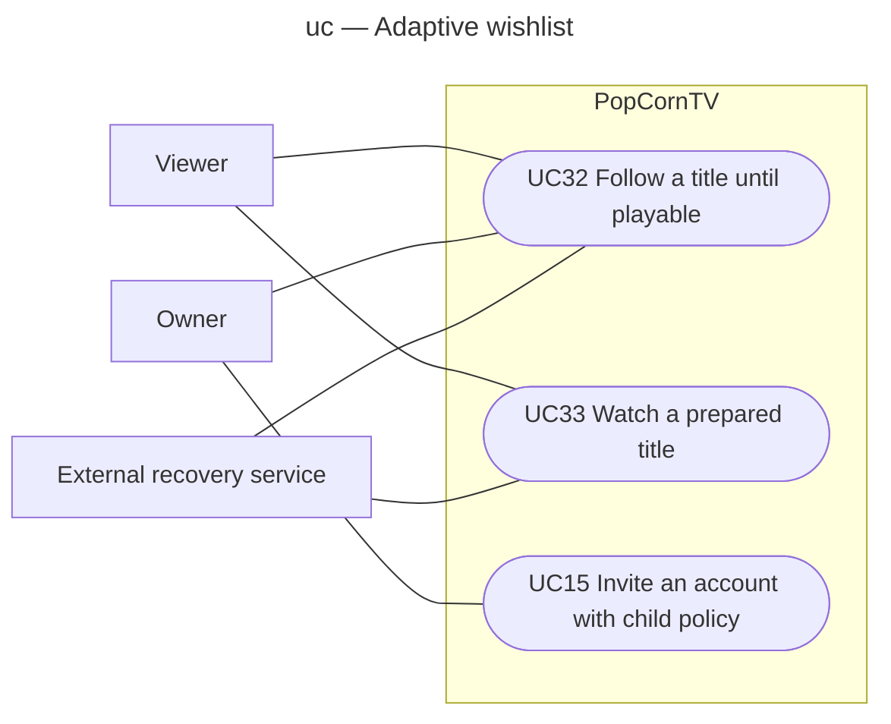

# Follow and watch wishlist titles

Analysis view, draft for #307. Mermaid approximates UML use-case notation. The scheduler is internal behavior, not an actor or a user goal.

Every signed-in viewer may trigger automatic preparation through their own wishlist. Owner participation is service configuration only, without per-title approval. Child accounts follow the owner-configured account policy set at invitation; UC15 is the existing invitation use case extended here. Series notifications are per ready episode. Goals and extensions are specified in `specs/adaptive-wishlist-lifecycle.md`.
