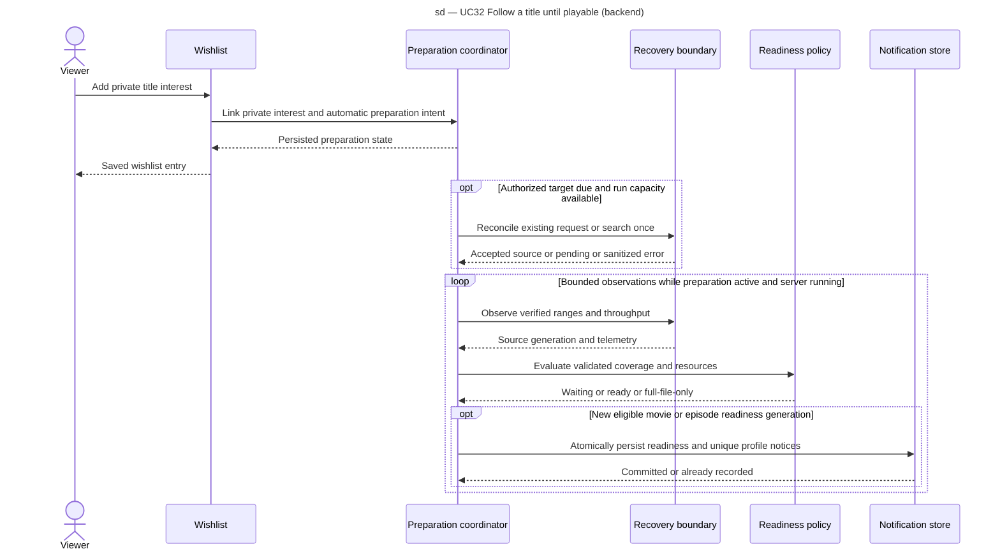

# Follow a wishlist title

SEQ-follow-wishlist, design responsibility view for UC32. All new participants are proposed responsibilities, not implemented classes. Profile/interest data stays local. A due tick is internal to the coordinator.

No-source results retain a daily due date, not an active-transfer poll. Transient failure uses persisted backoff. Unknown upstream write outcomes are reconciled before another write. Atomicity requires readiness and notification persistence in the same local transaction or an equivalently proven durable reconciliation contract, to be detailed in #309/#314.
