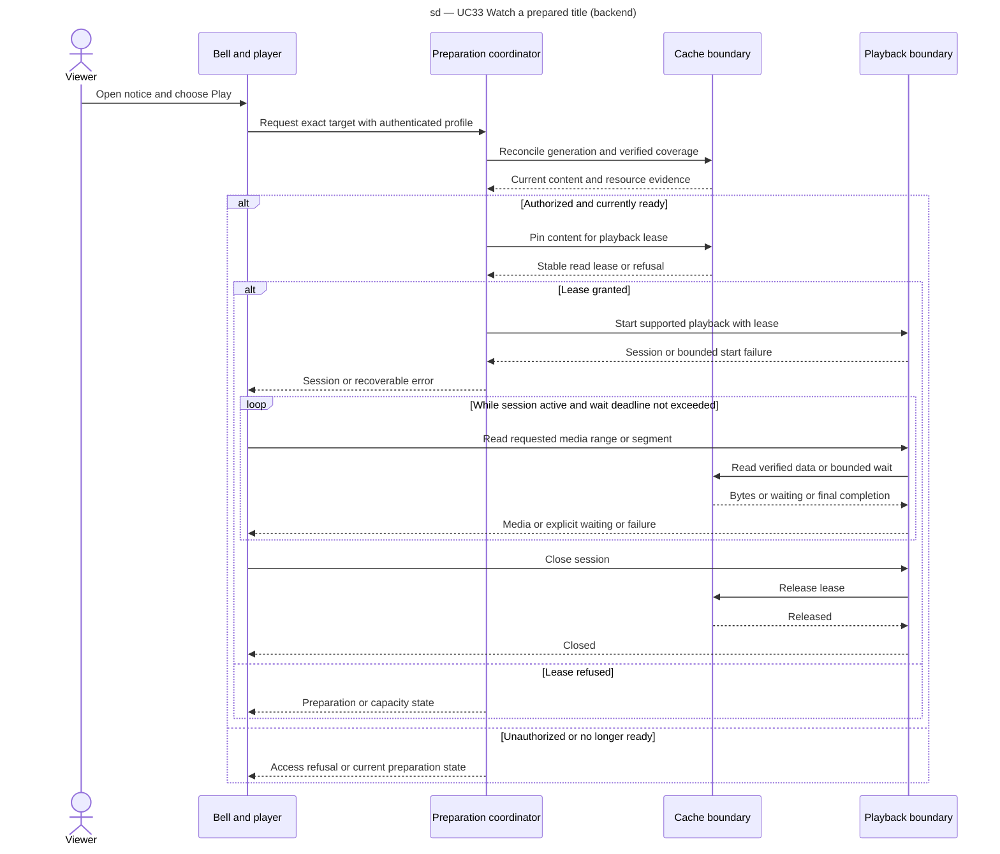

# Watch a prepared title

SEQ-play-prepared-title, UC33 design view. Recovery continues independently through SEQ-follow-wishlist. Existing file/HLS routes are reused only after their complete-file assumptions are addressed.

On start failure the playback boundary releases the lease. A disconnect, timeout or shutdown follows the same release guarantee. A seek outside verified coverage cannot read sparse holes. This view does not prescribe new endpoint names.
