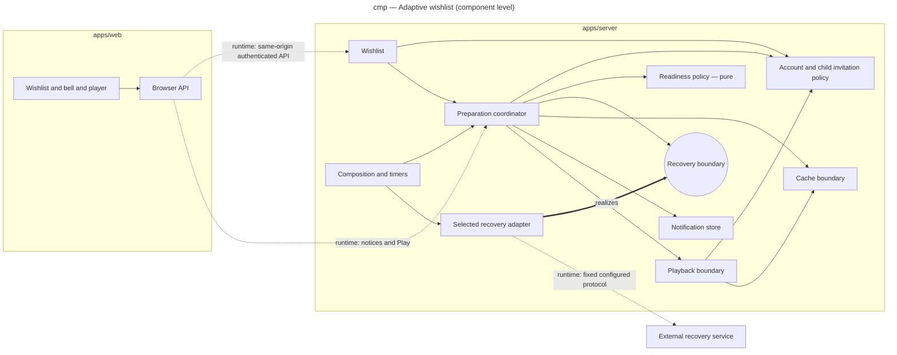

# Adaptive wishlist responsibilities

Component-level draft for #307. Solid edges indicate dependencies, dashed labeled edges indicate runtime calls. New names identify responsibilities to allocate after #308, not a mandated layer/class per box.

Only external IO substitution and invariant ownership justify boundaries. The pure policy imports no framework, database or network modules. The coordinator owns persisted transitions, not protocol mechanics. Authentication and per-profile checks wrap all browser calls. No deployment diagram is justified until backend/host selection. No design-class diagram is prescribed before protocol feasibility; the analysis domain concepts are in the spec.

ADR-0034 now accepts qBittorrent as the initial realization of the recovery boundary. REQ-28 keeps
multi-indexer discovery in the chosen Sonarr/Radarr/Prowlarr orchestration, not in a second poller.
REQ-29 preserves client-independent coordinator identities; future #325 may add a second concrete
adapter after its own design/tests. This diagram does not mandate an empty plugin registry or
claim that multiple adapters/services are currently installed. Source replacement remains bound
to a validated preparation generation, preserving active playback leases.
