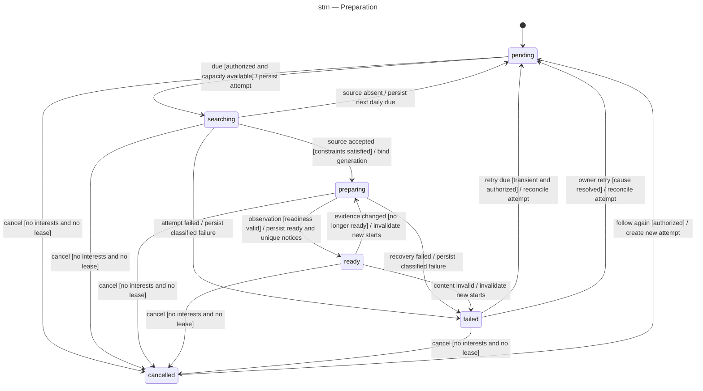

# Preparation lifecycle

One machine per shared movie/episode preparation. Draft enum and transition contract, not current runtime behavior. Public states remain independent of active playback leases. Invalid/unrecognized events are rejected without side effects; telemetry from a stale generation is ignored.

Internal behaviors (no state re-entry):
- Any state: `removeInterest` detaches only that subscriber. A denied `cancel` (interest or lease exists) is rejected without a transition. Cancellation stops orchestration; it does not authorize file deletion.
- An authenticated own-profile wishlist addition creates a pending intent automatically. Failed authentication/ownership creates no preparation. No per-title owner approval state exists. Missing backend configuration leaves pending with a reason and no external call.
- Pending: early tick or admission refusal stays pending without external search.
- Searching: uncertain submission stays reconciling within the bounded attempt, then a classified failure/backoff if unresolved. Duplicate callbacks are idempotent.
- Preparing: observations that do not establish readiness update the snapshot. Low sustained speed latches full-file-only for this attempt. Disk/capacity pause remains preparing with a reason.
- Ready: healthy observations preserve readiness and do not create more notifications. A new follower may receive their one initial notice. Play pins a separate lease without changing preparation state.
- Restart: revoke unverified readiness, reconcile generation/backend/cache and re-evaluate. Interrupted searching becomes a reconciliation attempt before any resubmission. A completed valid file may restore ready without a second notice.

Cancelled is not final: following again may create a new attempt. Failed is retryable only under the guards above. Source replacement first invalidates ready and then binds a new generation in preparing. Exact event/transition cases are listed in the traceability matrix.
