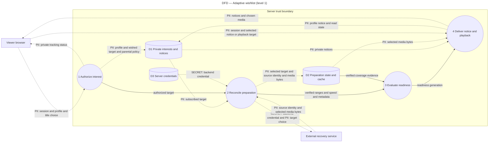

# Adaptive wishlist data flow

Level-1 DFD (not a UML type). Draft for #307. Every preference-bearing or credential-bearing edge is marked. External backend identity/policy remains unresolved in #308.

Signed-in users may request their own wishes automatically when their account policy permits. Child policy is configured by the owner at invitation and applied across profiles. Anonymous and cross-profile requests are rejected. Credentials/service permissions must be explicitly accepted before replacing the old owner-only acquisition boundary.

Profile identities, wishes, playback progress and watch history must not be forwarded to the recovery service. External title/source choices remain sensitive viewing preferences even without a username. Session credentials remain same-origin. Server keys stay in configuration, never the browser or logs. Local processing serves the requested playback feature; this is a purpose statement, not a legal-basis determination. Existing notices expire after 90 days. Interest follows wishlist lifecycle; preparation/cache metadata retention requires the deferred policy with explicit bounds before production. Cache byte admission is mandatory immediately and does not authorize automatic deletion.
