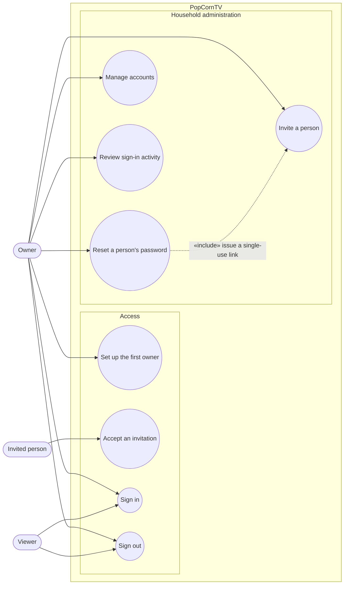

# Use case diagram — auth — accounts and sign-in

> **Feature**: user accounts and secure remote access — [spec](../../specs/auth.md)
> **Issue**: #18 · **Related ADRs**: ADR-0010 · Continues the numbering of
> [playback use cases](../playback/01-use-case.md) (UC1–UC10).

## Context

Who wants what once PopCornTV is reachable beyond the LAN. Use cases are goals started by
an actor; "session expired" or "login failed" are outcomes, not use cases. Which backend
or proxy does the work is shown in the [component diagram](03-component.md).

## Diagram

## Notes

- UC16 reuses the invitation mechanism: the owner issues a single-use link of kind
  `reset` (ADR-0010 §1). Email-based reset is a follow-up (spec §7).
- UC14 covers "this device" and "all my devices"; UC17 lets the owner end any account's
  sessions, change a role or delete an account.
- Existing use cases (UC3–UC10) now require a signed-in Viewer or Owner; UC1, UC2 and
  UC9 follow the role rules in spec §4.4.
