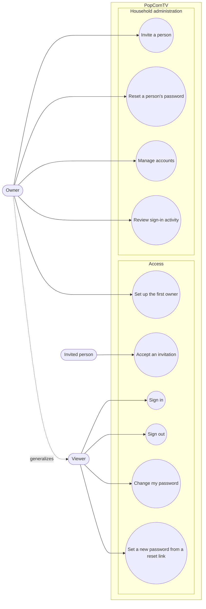

# Use case diagram — auth — accounts and sign-in

> **Feature**: user accounts and secure remote access — [spec](../../specs/auth.md)
> **Issue**: #18 · **Related ADRs**: ADR-0010 · Continues the numbering of
> [playback use cases](../playback/01-use-case.md) (UC1–UC10).

## Context

Who wants what once PopCornTV is reachable beyond the LAN. Use cases are goals started by
an actor; "session expired" or "login failed" are outcomes, not use cases. The proxy and
the server modules that do the work are in the [component](03-component.md) and
[deployment](08-deployment-prod.md) diagrams.

## Diagram

## Notes

- Owner generalizes Viewer: the owner can do everything a viewer can (Mermaid has no
  hollow-triangle arrow; the dotted edge stands for it).
- UC16 and UC15 share the single-use link mechanism; it is an implementation detail
  (sequence and class diagrams), not an «include».
- Existing use cases UC3–UC10 now require a signed-in Viewer; UC1 and UC2 are owner-only;
  UC9 (manage profiles) applies to each user's own profiles (spec §4.4).
