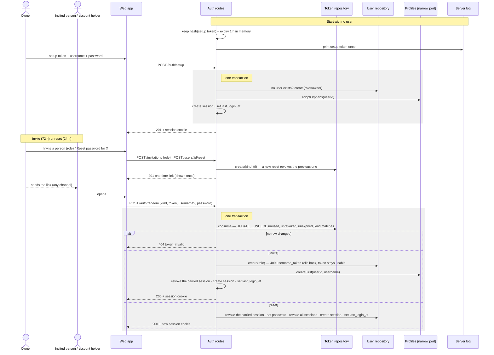

# Sequence diagram — auth — first owner, invitation and reset

> **Feature**: UC11 Set up the first owner, UC12 Accept an invitation, UC15 Invite a
> person, UC16 Reset a password, UC20 Set a new password — [use cases](01-use-case.md),
> [spec](../../specs/auth.md) · **Related ADRs**: ADR-0010

## Context

The flows that create or recover credentials without email. Every token is single-use
and expiring; only its SHA-256 is kept (in memory for setup, in `auth_tokens` for the
others). Each redeem runs in one database transaction.

## Diagram

## Notes

- `POST /auth/setup` answers `404` once any user exists; an exposed fresh install
  cannot be taken over without the log's token (ADR-0010 §4).
- The link is built from `PUBLIC_URL`; the token travels in the URL fragment, so it
  never reaches a proxy log or `Referer`.
