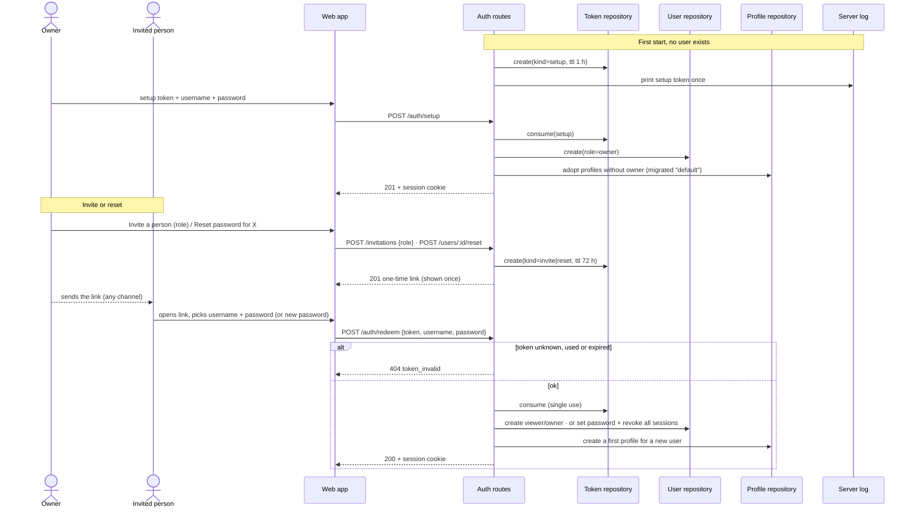

# Sequence diagram — auth — first owner, invitation and reset

> **Feature**: UC11 Set up the first owner, UC12 Accept an invitation, UC15 Invite a
> person, UC16 Reset a password — [use cases](01-use-case.md),
> [spec](../../specs/auth.md) · **Related ADRs**: ADR-0010

## Context

The three flows that create or recover credentials without email. All use a single-use,
expiring token; only its SHA-256 is stored.

## Diagram

## Notes

- `POST /auth/setup` answers `404` once any user exists, so an exposed fresh install
  cannot be taken over without the log's token (ADR-0010 §4).
- An expired setup token is replaced by a new one at the next server start.
- The link is built from `PUBLIC_URL`; the token travels in the URL fragment so it never
  reaches proxy logs or `Referer`.
