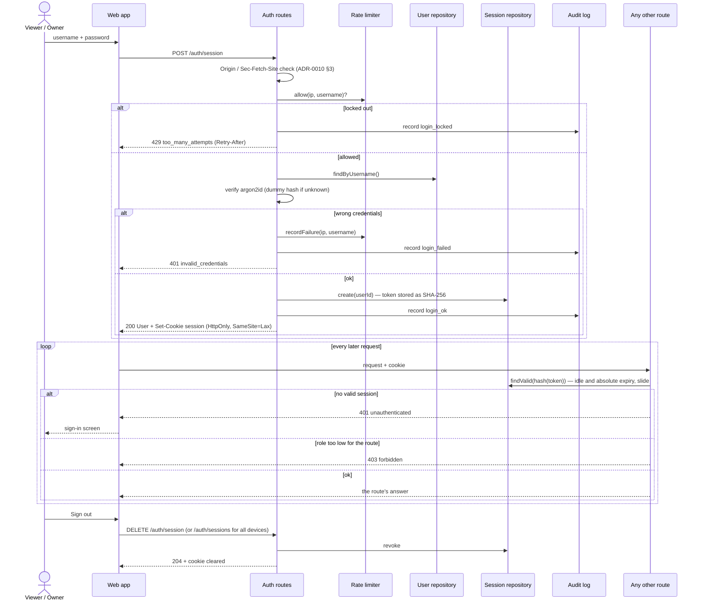

# Sequence diagram — auth — sign in and use a session

> **Feature**: UC13 Sign in, UC14 Sign out — [use cases](01-use-case.md),
> [spec](../../specs/auth.md) · **Related ADRs**: ADR-0010

## Context

How a username and password become a session cookie, how every later request is
checked, and where rate limiting and the audit log sit. Failure answers are identical
for an unknown user and a wrong password (no enumeration).

## Diagram

## Notes

- The rate limiter counts failures per (IP, username) and per IP; a success clears the
  pair. The client IP comes from the socket, or from the proxy only when `TRUST_PROXY`
  is set (spec §5).
- Static assets of the web app and `GET /health` stay public; nothing under `/api` does,
  except the routes in spec §4.3.
