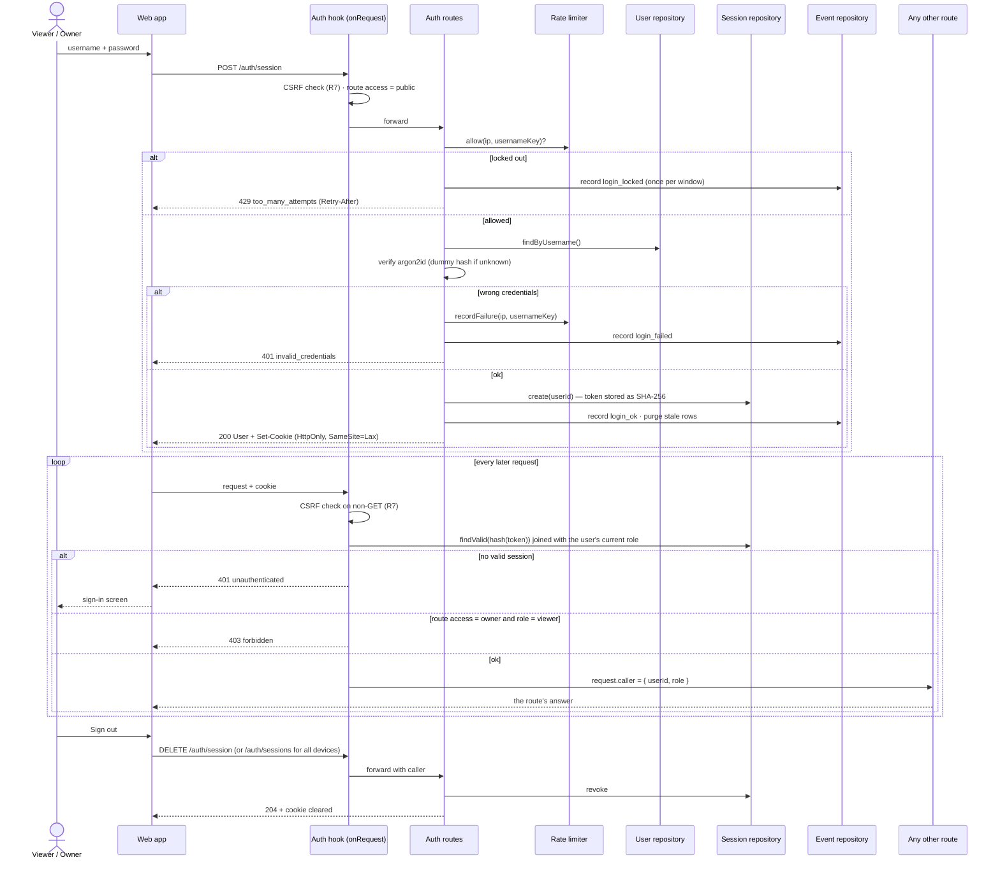

# Sequence diagram — auth — sign in and use a session

> **Feature**: UC13 Sign in, UC14 Sign out — [use cases](01-use-case.md),
> [spec](../../specs/auth.md) · **Related ADRs**: ADR-0010

## Context

How a username and password become a session cookie, how the single `onRequest` hook
checks every later request, and where rate limiting and the audit log sit. Failure
answers are identical for an unknown user and a wrong password (no enumeration).

## Diagram

## Notes

- Route paths are Fastify's; the browser calls them under `/api`, which Caddy strips
  (spec §5).
- `findValid` slides `last_seen_at` at most once per hour.
- The client IP comes from the socket, or from the proxy only when `TRUST_PROXY` is set.
