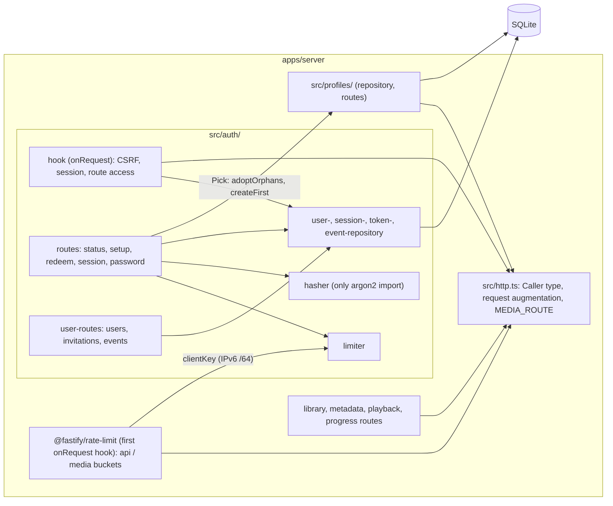

# Component diagram — auth — authentication in front of every route

> **Feature**: user accounts and secure remote access — [spec](../../specs/auth.md)
> §4.5 · **Related ADRs**: ADR-0010, ADR-0011 · Extends the
> [playback components](../playback/03-component.md); nodes and network are in the
> [deployment diagram](08-deployment-prod.md)

## Context

Which server modules authentication adds and how they depend on the existing ones. The
dependency direction keeps `auth` a leaf user of `profiles`, never the reverse.

## Diagram

## Notes

- The global rate limit (spec auth R13, ADR-0011) is the first root `onRequest` hook, so
  it runs before the auth hook and counts unauthenticated and unmatched requests. Routes
  marked `MEDIA_ROUTE` (`config.rateBucket: 'media'`) count in a bucket ten times larger;
  it reuses `clientKey` from `limiter` for the per-client key.
- One auth `onRequest` hook reads `request.routeOptions.config.access` (`public` | `owner` |
  absent = session); a new route is protected by default.
- `profiles`, `progress` and `playback` read `request.caller` through `src/http.ts` and
  never import `src/auth/`.
- The hasher is the only argon2 consumer, following the "single egress" modules
  (`ffprobe`, `tmdb-client`, `transcoder`); no interface while there is one
  implementation.
