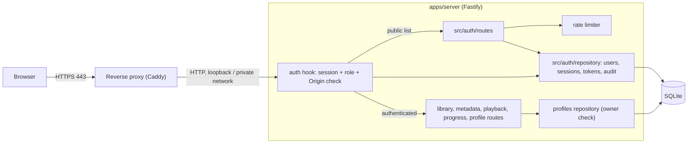

# Component diagram — auth — authentication in front of every route

> **Feature**: user accounts and secure remote access — [spec](../../specs/auth.md)
> **Related ADRs**: ADR-0010 · Extends the [playback components](../playback/03-component.md)

## Context

Where authentication sits and what faces the internet. Fastify never listens on a public
interface: the reverse proxy is the only exposed component.

## Diagram

## Notes

- The hook is a single Fastify `onRequest` hook with an explicit public allow-list
  (spec §4.3); a new route is protected by default.
- `src/auth/` follows the flat layout of the other modules; the password hasher is the
  only module importing the argon2 binding (swap point, ADR-0010 consequences).
- The proxy adds HSTS; the app keeps its own headers (#31). `TRUST_PROXY` tells Fastify
  which hop's `X-Forwarded-*` to believe.
