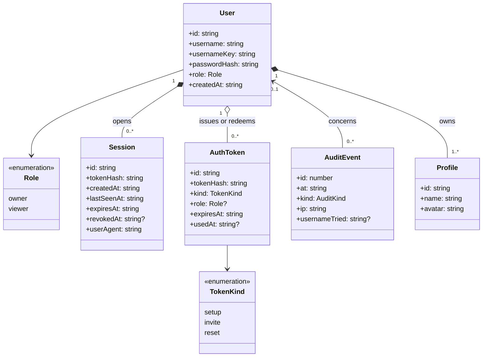

# Class diagram — auth — accounts, sessions, tokens, audit

> **Feature**: user accounts — [spec](../../specs/auth.md) §4.1 · **Related ADRs**:
> ADR-0010 (§5 profile ownership), ADR-0008

## Context

Persistent model added by #18 and its link to the profiles of #10. Cascades are database
foreign keys.

## Diagram

## Notes

- `Profile.userId` is a new NOT NULL foreign key (cascade); the migration leaves it
  nullable until `POST /auth/setup` adopts the existing profiles (ADR-0010 §5).
- `AuditEvent.userId` is nullable and `SET NULL` on delete, so history outlives an
  account. `usernameTried` is stored only for failures.
- `tokenHash` columns hold SHA-256 of a 256-bit random token; the raw value is never
  stored or logged.
