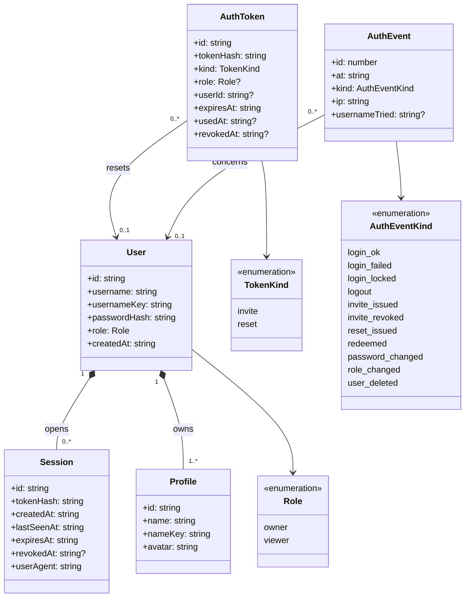

# Class diagram — auth — accounts, sessions, tokens, events

> **Feature**: user accounts — [spec](../../specs/auth.md) §4.1 · **Related ADRs**:
> ADR-0010 (§5 profile ownership), ADR-0008

## Context

Persistent model added by #18 and its link to the profiles of #10. Cascades are database
foreign keys. The setup token is not persisted (spec UC11).

## Diagram

## Notes

- `Profile.userId` is a nullable SQL column with an FK cascade; it is null only between
  migration `0006` and setup, and the repository never writes null. `(userId, nameKey)`
  is unique.
- `AuthEvent.userId` is `SET NULL` on delete, so history outlives an account.
- `tokenHash` holds SHA-256 of a 256-bit random token; the raw value is never stored or
  logged.
