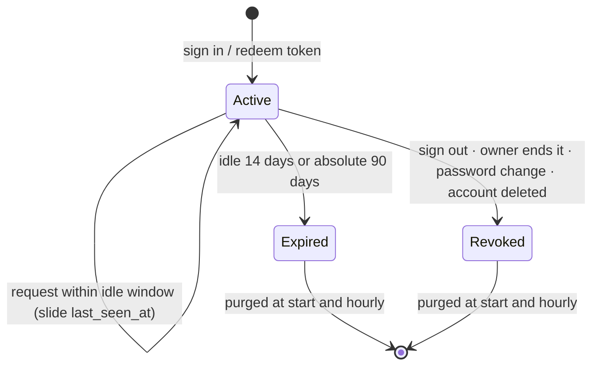

# State machine diagram — auth — session lifecycle

> **Feature**: UC13 Sign in, UC14 Sign out — [spec](../../specs/auth.md)
> **Related ADRs**: ADR-0010

## Context

A server-side session row, from creation to removal. The cookie only carries the opaque
token; every transition is decided server-side.

## Diagram

## Notes

- `Expired` and `Revoked` sessions are never accepted, even before the purge runs.
- A password change or reset revokes every session of that user except, for a change,
  the one performing it.
- Deleting an account deletes its sessions and its profiles (cascade, spec §4.1).
