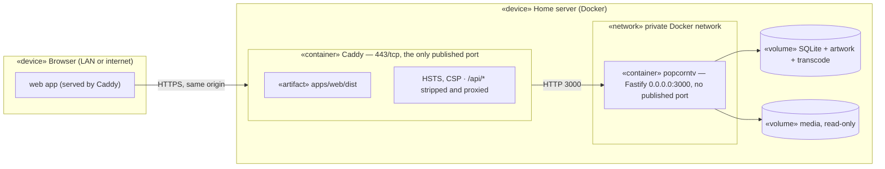

# Deployment diagram — auth — remote access through a reverse proxy

> **Feature**: secure remote access — [spec](../../specs/auth.md) §5 · **Related ADRs**:
> ADR-0010 · **Issue**: #18

## Context

The network boundary #18 opens: only Caddy faces the internet; Fastify is reachable on a
private Docker network only.

## Diagram

## Notes

- `PUBLIC_URL` is the Caddy origin; LAN clients use it too (one origin, R6).
- `TRUST_PROXY` on the app lists Caddy's fixed address: only that peer may set the
  client IP (spec auth §5).
- Local development keeps `127.0.0.1:3000:3000` and the Vite proxy; the production
  compose file publishes no app port.
