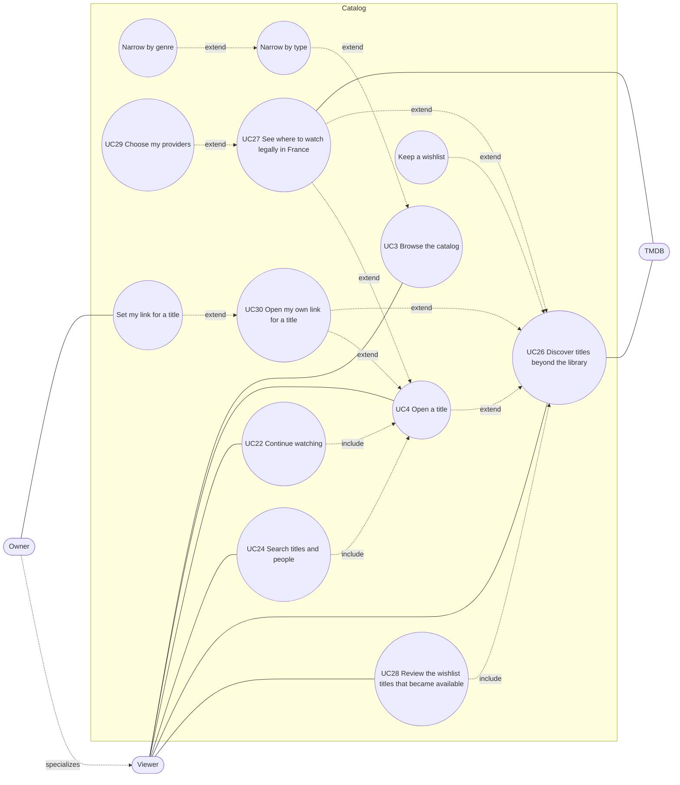

# Use case diagram — catalog

> **Feature**: UC3 Browse the catalog, UC4 Open a title ([spec](../../specs/catalog-grid.md)), UC22 Continue watching ([spec](../../specs/continue-watching.md)), UC24 Search ([spec](../../specs/search.md)), UC26 Discover and wishlist ([spec](../../specs/discover-wishlist.md)), UC27 See where to watch legally in France ([spec](../../specs/where-to-watch.md)), UC28 Review the wishlist titles that became available, UC29 Choose my providers ([spec](../../specs/wishlist-notifications.md)), UC30 Open my own link for a title ([spec](../../specs/title-link.md))
> **Related ADRs**: ADR-0004, ADR-0020, ADR-0029, ADR-0030, ADR-0031

## Diagram

## Notes

- *Narrow by genre* extends *Narrow by type*: genre options exist only once a type is
  chosen (progressive disclosure, state diagram 05).
- *Watch a title* (UC5, #7) will extend UC4 from the detail dialog.
- *Keep a wishlist* extends UC26 from the title sheet; UC4 extends UC26 at the extension point
  *title on disk* (**Play in my library**). TMDB is a secondary actor reached by the server.
- UC27 extends UC26 (title sheet) and UC4 (detail dialog): the viewer leaves for a legal provider's
  page (ADR-0029); PopCornTV never plays that stream.
- UC29 extends UC27: a "Mine" toggle on an offer (spec wishlist-notifications R2). UC28 opens
  the bell panel; a line includes UC26's title sheet. The availability check itself is a
  timer (sequence 10), not a use case.
- UC30 extends UC26 and UC4: a viewer opens the owner's link in a new tab; only the Owner
  sets it (*Set my link for a title*, ADR-0031). PopCornTV never fetches the link.
