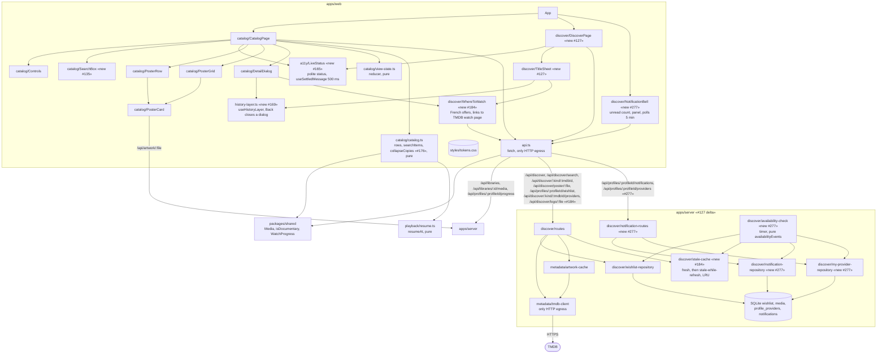

# Component diagram — catalog (apps/web)

> **Feature**: UC3 / UC4 / UC22 / UC24 / UC26 / UC27 / UC28 / UC29 ([spec](../../specs/catalog-grid.md), [continue-watching](../../specs/continue-watching.md), [where-to-watch](../../specs/where-to-watch.md), [wishlist-notifications](../../specs/wishlist-notifications.md))
> **Related ADRs**: ADR-0001, ADR-0004, ADR-0020, ADR-0024, ADR-0026, ADR-0029, ADR-0030

## Diagram

## Notes

- Flat layout (architecture rule: no layers without a force): two pure modules hold all
  the logic and are unit-tested; components only render.
- #127: Discover never talks to TMDB from the browser (ADR-0020); availability of a wishlist
  entry is a join on `media.tmdb_id` in `wishlist-repository`.
- #184: `WhereToWatch` shows the French legal offers on both sheets; an offer is a plain
  link to the TMDB watch page (ADR-0029). Lists and providers share `stale-cache`.
- #277: `availability-check` runs on a timer (ADR-0016 pattern), reads offers through the
  shared `stale-cache` and writes in-app notifications (ADR-0030); `NotificationBell` polls them.
