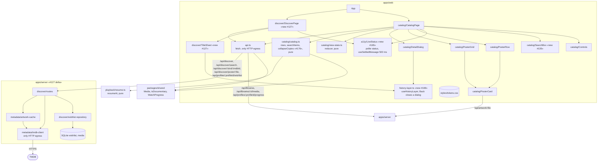

# Component diagram — catalog (apps/web)

> **Feature**: UC3 / UC4 / UC22 / UC24 / UC26 / UC27 ([spec](../../specs/catalog-grid.md), [continue-watching](../../specs/continue-watching.md))
> **Related ADRs**: ADR-0001, ADR-0004, ADR-0020, ADR-0024, ADR-0026

## Diagram

## Notes

- Flat layout (architecture rule: no layers without a force): two pure modules hold all
  the logic and are unit-tested; components only render.
- #127: Discover never talks to TMDB from the browser (ADR-0020); availability of a wishlist
  entry is a join on `media.tmdb_id` in `wishlist-repository`.
