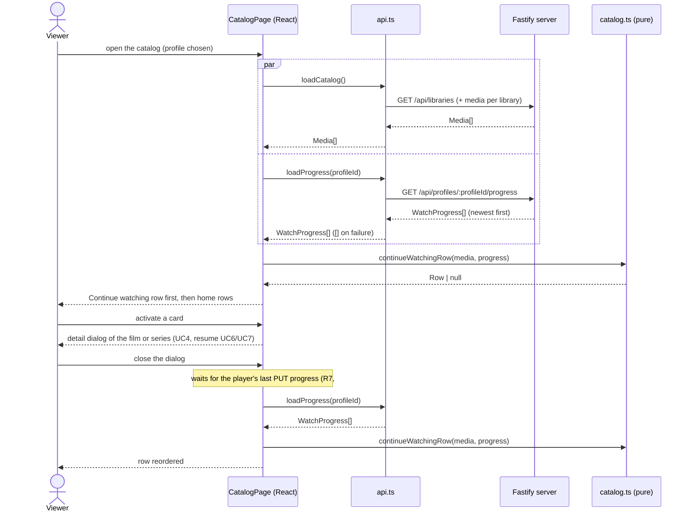

# Sequence diagram — catalog — continue watching

> **Feature**: UC22 ([spec](../../specs/continue-watching.md))
> **Related ADRs**: ADR-0007, ADR-0015 · **Issues**: #140

## Diagram

## Notes

- The join is pure and runs in the browser over data the page already holds
  (ADR-0015); the server is unchanged.
