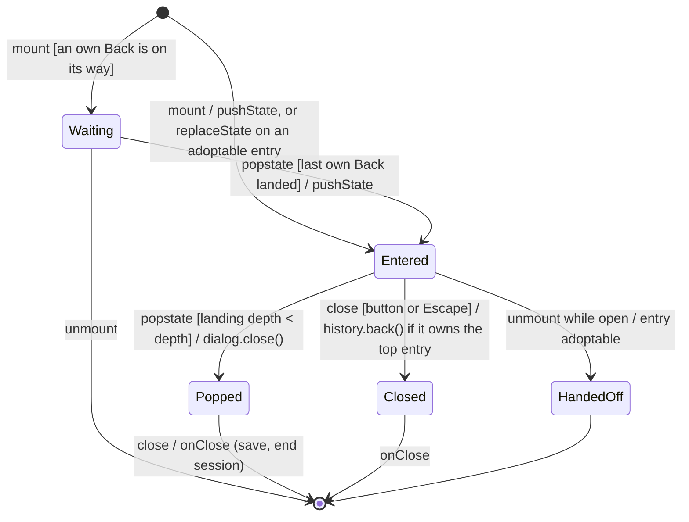

# State diagram — a modal layer on the history stack

The lifecycle of one `<dialog>` layer (detail dialog, player, title sheet) under
`useHistoryLayer`.

> **Feature**: UC4 / UC5–UC7 / UC26 ([spec](../../specs/history-back.md))
> **Related ADRs**: ADR-0024

## Diagram

## Notes

- Several layers popped by one Back close top first (`closingOrder`).
- "Owns the top entry" counts the Backs still on their way (`ownsTop`).
