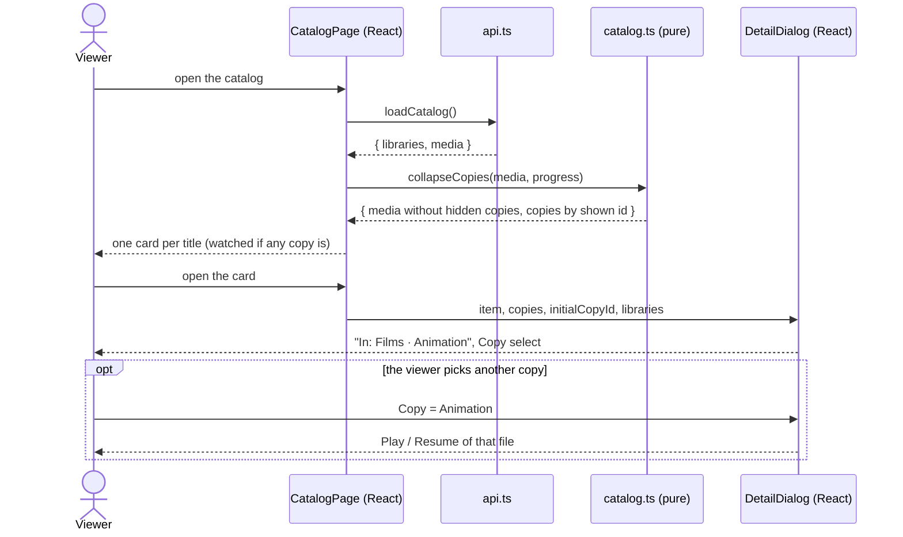

# Sequence diagram — catalog — duplicate titles

How a title found in two libraries becomes one card and a copy picker.

> **Feature**: UC3 / UC4 ([spec](../../specs/duplicate-titles.md))
> **Related ADRs**: ADR-0026 · **Issues**: #176

## Diagram

## Notes

- R3: the shown copy is the one saved most recently, else the first in library order.
