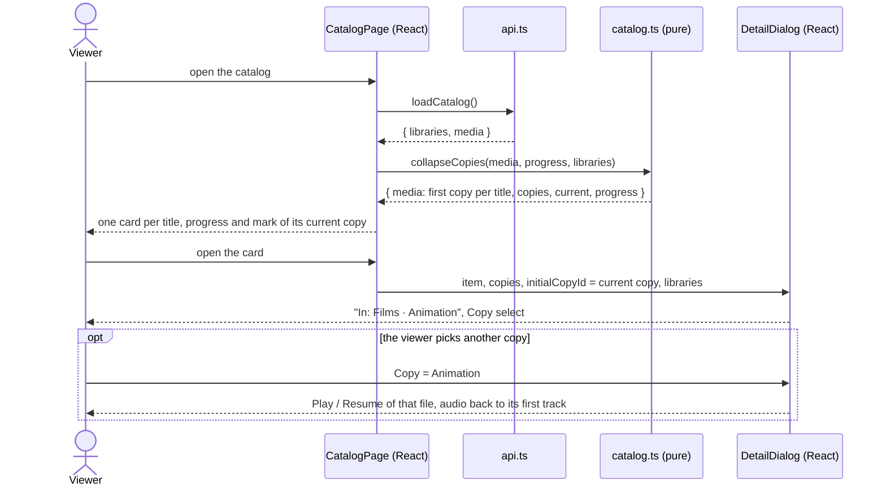

# Sequence diagram — catalog — duplicate titles

How a title found in two libraries becomes one card and a copy picker.

> **Feature**: UC3 / UC4 ([spec](../../specs/duplicate-titles.md))
> **Related ADRs**: ADR-0026 · **Issues**: #176

## Diagram

## Notes

- R3: the card is always the first copy in library order, so it keeps its focus across a
  progress reload; the current copy (saved most recently, else the first) drives its
  progress, watched mark and Continue watching entry.
