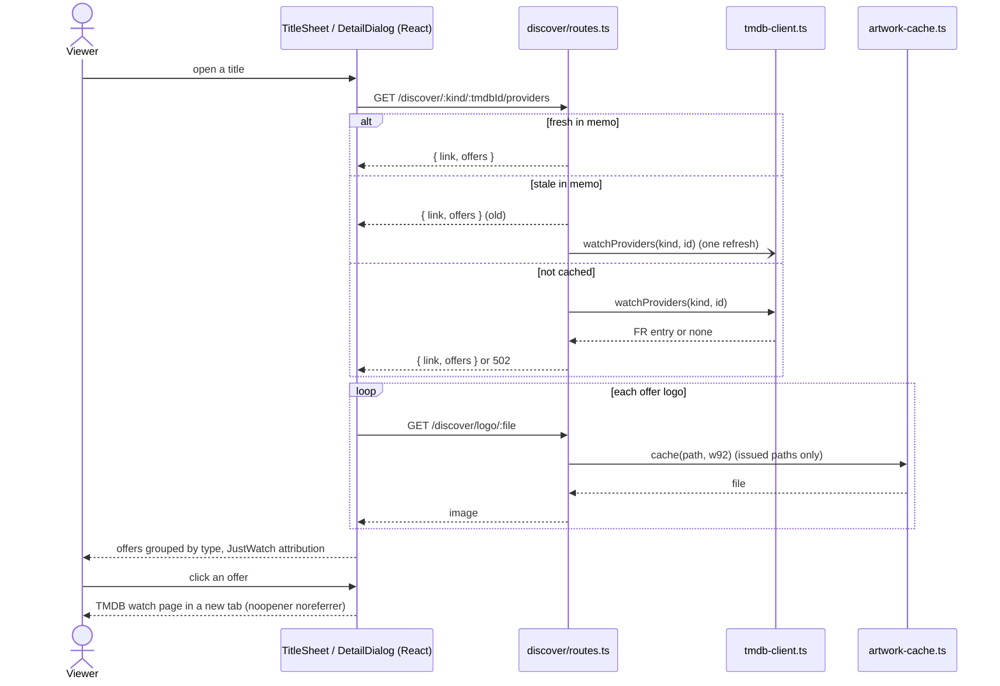

# Sequence diagram — catalog — where to watch

How a title sheet gets its French legal offers and a viewer leaves for a provider.

> **Feature**: UC27 ([spec](../../specs/where-to-watch.md))
> **Related ADRs**: ADR-0027, ADR-0029 · **Issues**: #184

## Diagram

## Notes

- R8: no stream crosses PopCornTV; the last step is a plain link.
