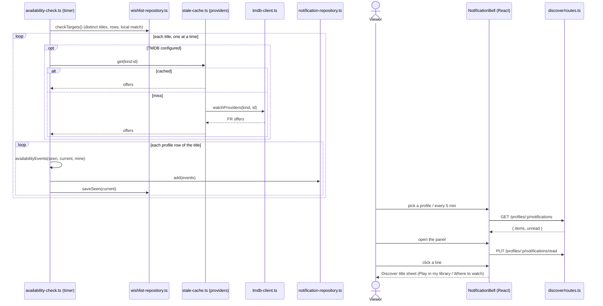

# Sequence diagram — catalog — wishlist availability check

How the timer turns a wishlist title's arrival into an in-app notification, and how the
viewer reads it.

> **Feature**: UC28 ([spec](../../specs/wishlist-notifications.md))
> **Related ADRs**: ADR-0016, ADR-0027, ADR-0030 · **Issues**: #277

## Diagram

## Notes

- R7: a TMDB failure for a title is logged and leaves its `seen` state as it was.
