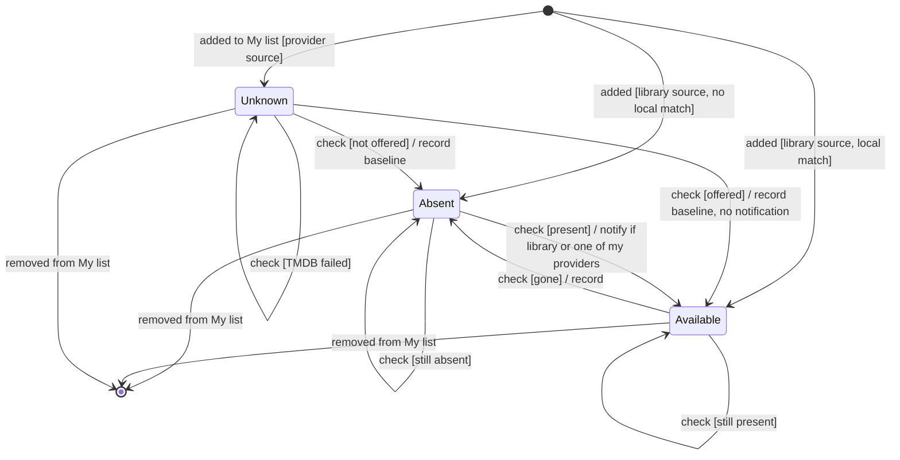

# State diagram — catalog — availability of a wishlist title on one source

The life of one source (the library, or one provider) for one wishlist row, as the check sees
it; a notification is the effect of entering **Available** from **Absent**.

> **Feature**: UC28 ([spec](../../specs/wishlist-notifications.md))
> **Related ADRs**: ADR-0030 · **Issues**: #277

## Diagram

## Notes

- A TMDB failure leaves any state as it was (R7). Adding a provider to "mine" changes no
  state, so it never notifies for an offer already seen (R5).
