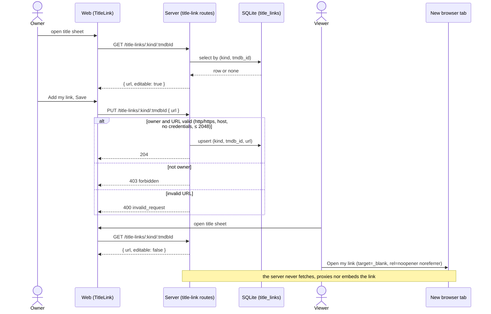

# Sequence — set and open a personal title link

The owner saves a link for a title; a viewer later opens it in a new tab without the server
ever reaching the link.

> **Feature**: UC30 Open my own link for a title ([spec](../../specs/title-link.md))
> **Related ADRs**: ADR-0031

