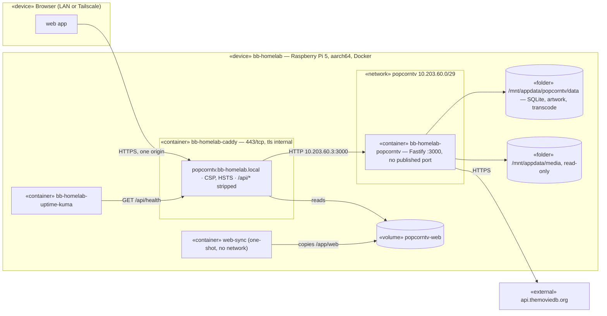

# Deployment diagram — homelab — PopCornTV on bb-homelab

> **Feature**: homelab deployment — [spec](../../specs/homelab-deploy.md) · **Related
> ADRs**: ADR-0013, ADR-0010 · **Issue**: #60, #46

## Context

Where each artifact runs once PopCornTV replaces Jellyfin on the owner's Raspberry Pi. It
refines the generic [auth deployment](../auth/08-deployment-prod.md) with the real host,
network and paths.

## Diagram

## Notes

- Caddy is `10.203.60.2` on the `popcorntv` network, the only `TRUST_PROXY` peer.
- `popcorntv` and `web-sync` run the same image tag, so web and API never drift.
- The nightly bb-homelab backup copies `data/backup/popcorntv.sqlite`.
