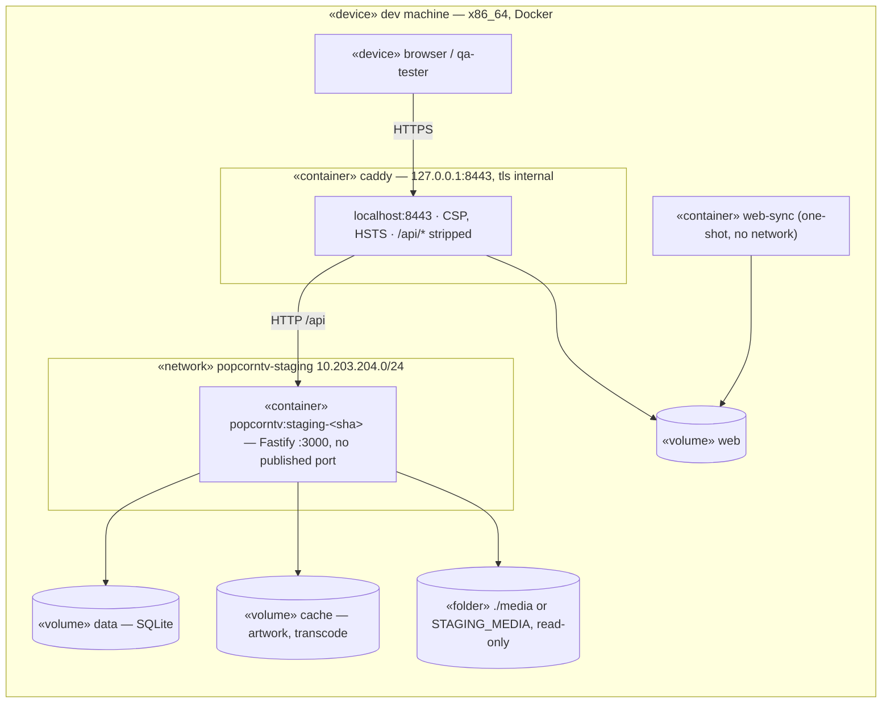

# Deployment diagram — deploy — PopCornTV local staging on the dev machine

> **Feature**: local staging — [spec](../../specs/deploy-homelab.md) · **Related ADRs**:
> ADR-0013 · **Issue**: #204

## Context

Where QA passes run before the owner decides a Pi deploy (owner rule 2026-11-08). It mirrors
the [production deployment](08-deployment-prod.md) on the dev machine: same image, same
`web-sync` one-shot, same Caddy site block over `tls internal`. Derogation to the global
staging rule (staging on the prod platform): the Pi is the only prod host and a build there
takes about 15 minutes, so staging runs the same image on the dev machine instead.

## Diagram

## Notes

- `make staging-up` builds `git archive HEAD`, so the tag always names the code inside it.
- Differences from production, on purpose: named volumes instead of the HDD bind mounts, no
  `tailnet_only` (loopback only), the local CA regenerated at each start.
