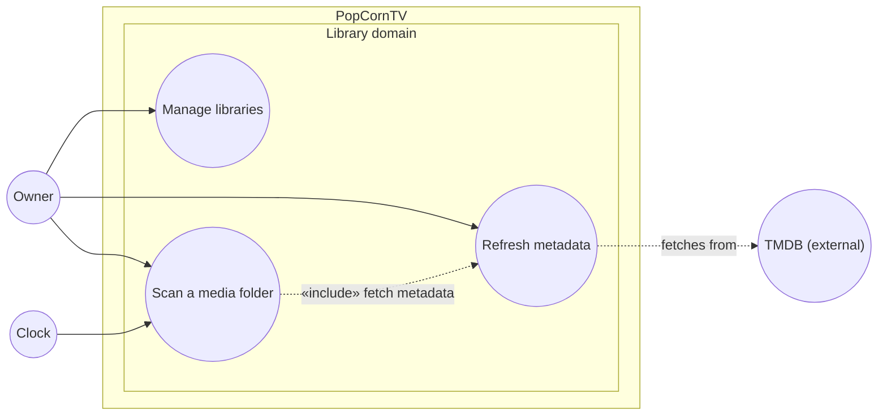

# Use case diagram — library — manage libraries

> **Feature**: Library management — [spec](../../specs/library-management.md)
> **Related ADRs**: ADR-0014

## Context

The owner's library goals once the web app manages them. UC1 and UC2 already exist
([playback use cases](../playback/01-use-case.md)); UC21 adds add, rename and delete.

## Diagram

## Notes

- UC21 covers add, rename and delete; the Scan button pressed after an add starts UC1 as a
  separate goal, not an «include».
- The Clock is a time actor: every `SCAN_INTERVAL_MIN` minutes it starts UC1 on each
  library (#132, ADR-0016, spec [scheduled-scan](../../specs/scheduled-scan.md)).
- The empty-catalog welcome panel is an entry point to UC21, not a use case.
