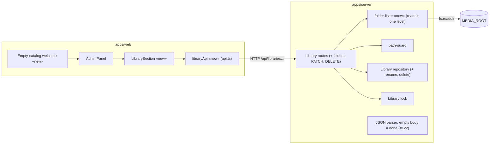

# Component diagram — library — delta for library management

> **Feature**: Library management — [spec](../../specs/library-management.md)
> **Related ADRs**: ADR-0014 · Full structure: [playback component](../playback/03-component.md)

## Context

Only what #123 adds or changes; new elements are marked «new».

## Diagram

## Notes

- `folder-lister` is the only new filesystem read; it never follows symbolic links.
- The dependency rule holds: the web depends on the shared contracts only.
