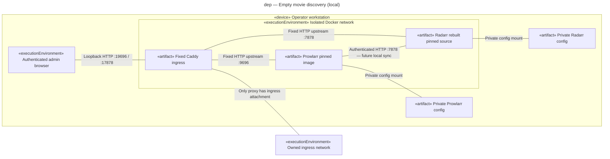

# Deployment diagram — local discovery

This view separates the empty discovery services from PopcornTV staging and future VPN retrieval.

> **Feature:** #327 · **Source:** [Topology contract](../../specs/local-discovery-topology.md)
> **Realises:** REQ-34–37 · **Status:** owner-approved local topology, including #345 fixed ingress

## Context

Only the operator's local machine is in scope. Private addresses are allocated after collision
checks; the diagram records roles and standard service ports, not machine-specific addresses.
Mermaid approximates UML deployment notation through stereotyped nested nodes.

## Diagram

## Notes

No external indexer, download client, Internet egress or permanent-media path is attached.
Local synchronization is not already configured by a line in the diagram. PopcornTV's future
#310 cadence and #328 VPN network are outside this deployment; no staging/Pi change occurs.

The proxy has a separately allocated ingress subnet; both application containers remain
attached only to the internal network. Effective bindings, network membership and authenticated
loopback requests are verified after publication. Local ephemeral fixture ports keep the
acceptance journey independent of the operator installation. The Pi uses the existing central
`bb-homelab` Caddy; this local proxy does not replace or modify it.
