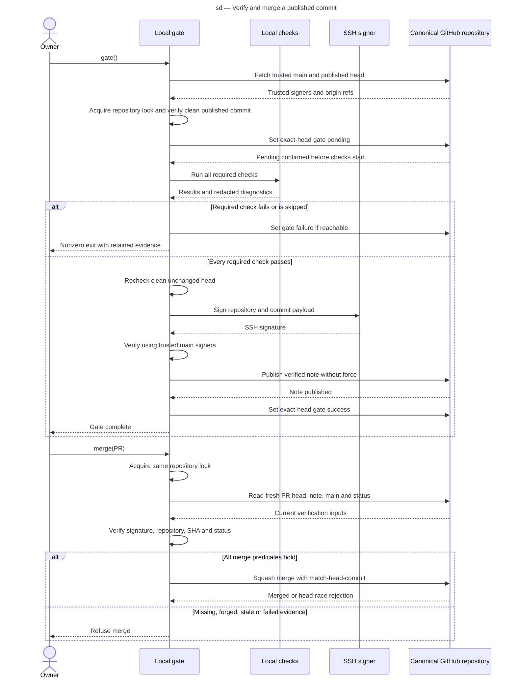

# Sequence diagram — signed local gate

This interaction shows when a checked commit becomes eligible for an exact-head merge.

> **Feature:** #329 — signed local gate
> **Source spec:** [Local gate protocol](../../specs/local-gate-protocol.md)
> **Realises:** REQ-30–32 · **ID:** SEQ-attest-local-gate
> **Decisions captured:** owner-accepted two-PR trust bootstrap and primary signing identity

## Context

The sequence starts after the signer trust store has merged to main. It covers one operator
and one gate run. GitHub is metadata/transport only; checks execute on the local machine.

## Diagram

## Notes

Any publication, signing or verification error ends the gate without success. The
specification defines bounded note-ref retries and unsupported cross-machine concurrency.
The future squash commit requires fresh verification before any deployment.
Gate and merge hold the same lock through their final response, preventing a local rerun
from racing a merge's status read. Pending publication failure aborts before checks and
does not revoke already valid remote evidence.
