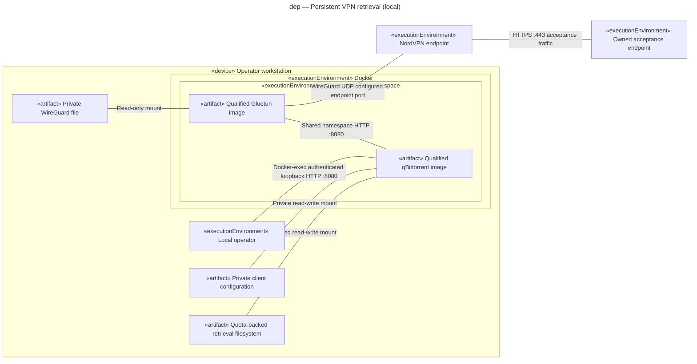

# Deployment diagram — persistent VPN retrieval

This local view makes the sole public egress path and separate storage boundary explicit.

> **Feature:** #328 · **Source:** [Specification](../../specs/nordvpn-retrieval.md)
> **Realises:** REQ-38–42 · **Status:** implemented (#328); component-tested, runtime acceptance owner-run and pending on this head

## Diagram

## Notes

Mermaid approximates UML deployment notation. The operator README records qualified immutable image identities. No host port is published. No independent client network, library mount, public
admin port, discovery network or player route is present. The external acceptance endpoint
is controlled test traffic, not a configured acquisition source. The shared namespace's
firewall must reject all client egress outside the tunnel, including during restart.
