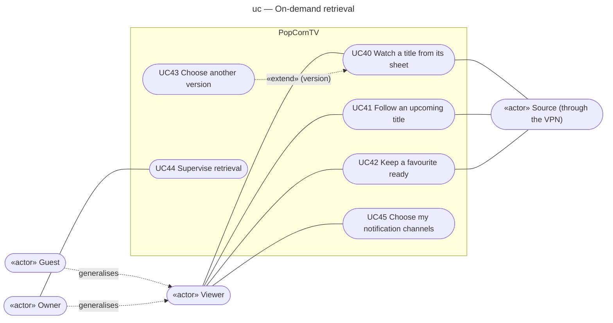

# Use case diagram — on-demand retrieval

> **Feature**: epic #306 redefined by #434 — UC40–UC45
> **Requirements**: [08-on-demand-retrieval.md](../../../requirements/08-on-demand-retrieval.md)
> **Related ADRs**: ADR-0034, ADR-0043, ADR-0044, ADR-0045, ADR-0046, ADR-0047

## Diagram

Generalisation: a guest and the owner can do everything a viewer can; a guest is bounded by its
quota (REQ-57). Children are out of scope until #316.

## Descriptions

### UC40 Watch a title from its sheet — user goal, slice 1

- **Primary actor**: viewer. **Supporting actor**: source.
- **Precondition**: signed in, adult account, profile chosen; the film has a TMDB identity.
- **Trigger**: the viewer opens the film's sheet.
- **Main scenario**:
  1. The system starts the prefetch of the start buffer of the best conforming version.
  2. The Play button fills as the start buffer grows.
  3. The viewer presses Play when the button is full.
  4. Playback starts within 3 s; the rest of the file is retrieved during playback.
  5. The viewer closes the player; the retrieval stops and the bytes stay.
- **Extensions**:
  - 1a. The title is in the library (`MEDIA_ROOT`): no retrieval, existing playback.
  - 1b. No source: the title is offered for « À venir » (UC41).
  - 1c. Only degraded versions: the sheet shows their reasons (UC43).
  - 1d. Cache full after eviction: the sheet says "no space for now" (REQ-53).
  - 1e. Account over quota: the request waits and the sheet says so (REQ-57).
  - 2a. The cap is reached before the no-stall need: the button is full and "playback may pause".
  - 3a. Play before the button is full: top priority, the sheet stays until the first frame.
  - 4a. Seek into a missing part: that part is retrieved first, bounded wait.
  - 4b. Source or VPN down: the buffer plays out, pause, auto-resume, Retry (REQ-56).
  - 5a. Not played within 6 h of the last sheet opening: the prefetch is purged.
- **Postcondition**: the last playback time is recorded; deletion follows 48 h later (REQ-51).

### UC43 Choose another version — user goal, slice 1

- **Primary actor**: viewer. **Extends** UC40 at "version".
- **Main scenario**: the viewer opens "Other versions", reads each verdict (conforming or degraded
  with its reasons) and picks one; the prefetch switches to it; the previous partial bytes are
  dropped unless another profile plays them.

### UC41 Follow an upcoming title — user goal, slice 3

- **Primary actor**: viewer. **Supporting actor**: source.
- **Trigger**: the viewer adds a title with no source to « À venir ».
- **Main scenario**: the system searches at the age-based cadence (REQ-44); when a source appears,
  each following profile is notified once (REQ-45) and the title leaves « À venir ».
- **Extensions**: unreleased → release date and countdown, search starts at release; degraded only
  → notified as degraded.

### UC42 Keep a favourite ready — user goal, slice 3

- **Primary actor**: viewer. **Supporting actor**: source.
- **Main scenario**: the viewer marks a title as favourite; the first third is retrieved at once and
  kept; after a playback it is trimmed back to the first third 48 h later (REQ-52).

### UC45 Choose my notification channels — user goal, slice 3

- **Primary actor**: viewer.
- **Main scenario**: in the profile settings the viewer turns Web Push and e-mail on or off, picks
  immediate e-mail or a daily digest and the push quiet hours; the bell stays on (REQ-59).

### UC44 Supervise retrieval — user goal, slice 4

- **Primary actor**: owner.
- **Main scenario**: the owner sees current activity and cancels an item, reads disk usage, history
  and logs, opens Statistics, adjusts the ceiling, the bandwidth cap and the quotas
  (REQ-53, REQ-57, REQ-60, REQ-61).
