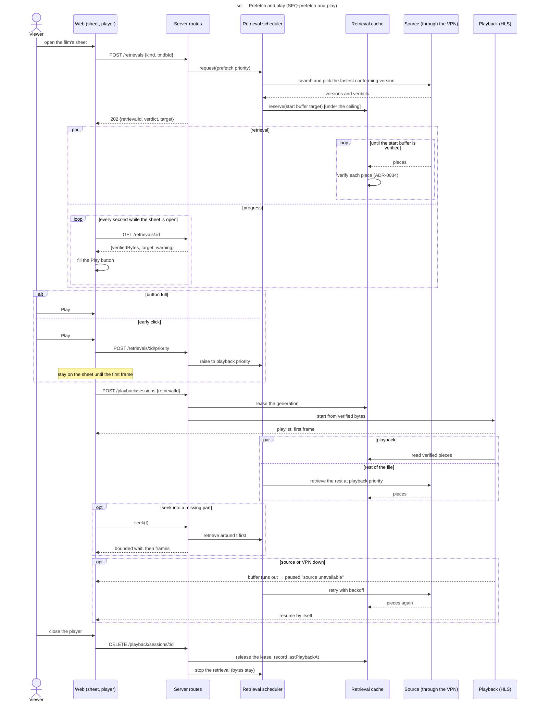

# Sequence diagram — on-demand retrieval — prefetch and play

> **Feature**: UC40 (SEQ-prefetch-and-play), slice 1
> **Requirements**: REQ-46–51, REQ-56, NFR-16
> **Related ADRs**: ADR-0034, ADR-0043, ADR-0044, ADR-0046

## Diagram

Route names are indicative: the HTTP contract is fixed in the slice 1 implementation issue, with
its zod schemas in `packages/shared`.
