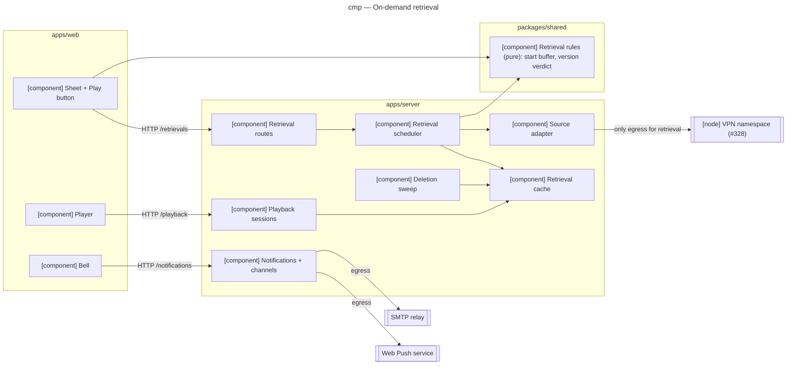

# Component diagram — on-demand retrieval

> **Feature**: epic #306 redefined by #434
> **Related ADRs**: ADR-0028, ADR-0034, ADR-0043, ADR-0044, ADR-0047

## Diagram

## Responsibilities

- **Retrieval rules**: pure functions shared by server and web; no IO.
- **Scheduler**: priorities, quotas, bandwidth cap; the only component that talks to the source
  adapter.
- **Cache**: generations, verified ranges, reservations under the ceiling, eviction, leases.
- **Deletion sweep**: 6 h purge, 48 h deletion, favourite trim; serial timer.
- **Source adapter**: search and retrieval through the VPN namespace; replaceable by a test double
  (NFR-17); never sees a profile.
- **Notifications + channels**: bell (existing), Web Push and e-mail (slice 3).

Dependency rule: routes and sweep depend on the cache and the scheduler; nothing in
`packages/shared` imports the server; the source adapter is injected.
