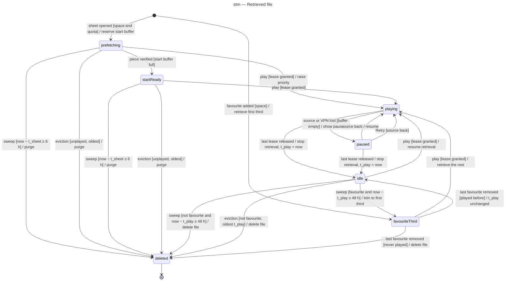

# State machine diagram — on-demand retrieval — retrieved file

> **Feature**: UC40, UC42 — file lifecycle
> **Requirements**: REQ-46, REQ-47, REQ-50–53, REQ-56
> **Related ADRs**: ADR-0034, ADR-0043, ADR-0044, ADR-0045

One machine per retrieved title (shared by profiles). Files under `MEDIA_ROOT` have no such
machine. Times: `t_sheet` = last sheet opening, `t_play` = last playback end.

## Diagram

## Rules

- `playing` holds at least one lease: never evicted, never deleted (REQ-51, REQ-53).
- `favouriteThird` is never evicted; it leaves only by a playback or the last favourite removal.
- `idle` keeps retrieving nothing; the 48 h clock starts at the last lease release.
- Internal transitions (no state change): a sheet opening in any state refreshes `t_sheet`; a new
  lease in `playing` increments the lease count.
- An event not listed for a state is rejected without effect; the sweep also runs at start-up so a
  restart never skips an overdue deletion.
- Removing the last favourite from `favouriteThird` goes to `idle` with the old `t_play`: the 48 h
  rule then deletes it at the next sweep if the delay has passed. A third that was never played
  has no `t_play`: it is deleted at once.
