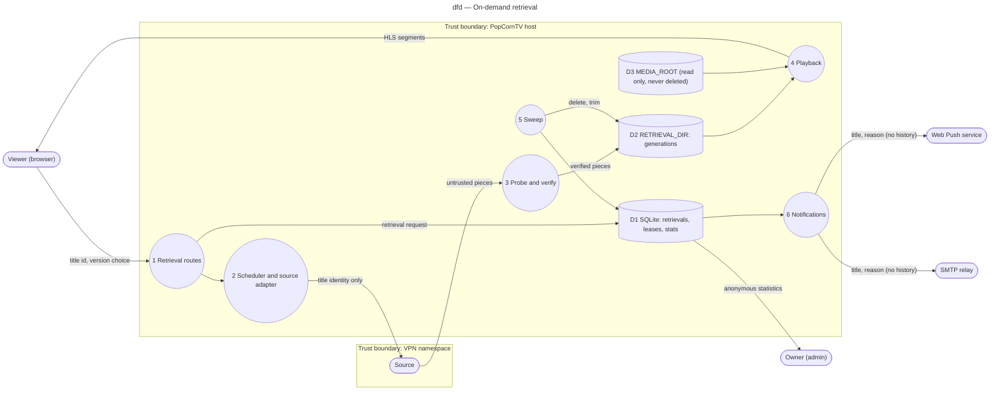

# Data flow diagram — on-demand retrieval

> **Feature**: epic #306 redefined by #434 — trust boundaries and egress
> **Requirements**: REQ-55, REQ-56, NFR-18, NFR-19
> **Related ADRs**: ADR-0021, ADR-0028, ADR-0034, ADR-0047

## Diagram

## Threats and controls

| Flow | Threat | Control |
|---|---|---|
| Source → 3 | Malicious or mislabelled file | Only video and subtitle files; ffprobe with `localInputArgs`; nothing executed (REQ-55, ADR-0028) |
| Source → 3 | Corrupt or substituted bytes | Piece digests, generation binding (ADR-0034) |
| 2 → Source | Leak outside the VPN | Kill switch: no VPN, no egress (REQ-56, #328) |
| 2 → Source | Profile data leak | Title identity only (NFR-18) |
| 5 → D2/D3 | Deleting the owner's library | Sweep confined to `RETRIEVAL_DIR`; `MEDIA_ROOT` read only |
| 6 → Push/Mail | Watch history leak | Message carries the title and the reason only (ADR-0047) |
| D1 → Owner | Nominative statistics | Statistics anonymous; history nominative with members informed (NFR-19) |
