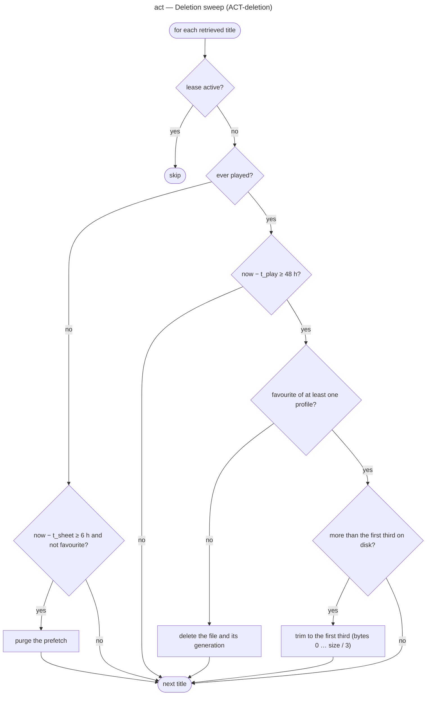

# Activity diagram — on-demand retrieval — deletion sweep

> **Feature**: UC40, UC42 (ACT-deletion)
> **Requirements**: REQ-46, REQ-51, REQ-52
> **Related ADRs**: ADR-0045

Runs every 15 min on the serial timer and once at start-up, for each retrieved title.

## Diagram

## Rules

- "First third" is the byte range from 0 to one third of the file size, rounded up to whole
  verified pieces.
- An abandoned playback counts as a playback: the 48 h start at the last lease release.
- Deletion removes the generation's files and its rows except the anonymous statistics.
- A title never played but marked favourite keeps its first third (REQ-52).
