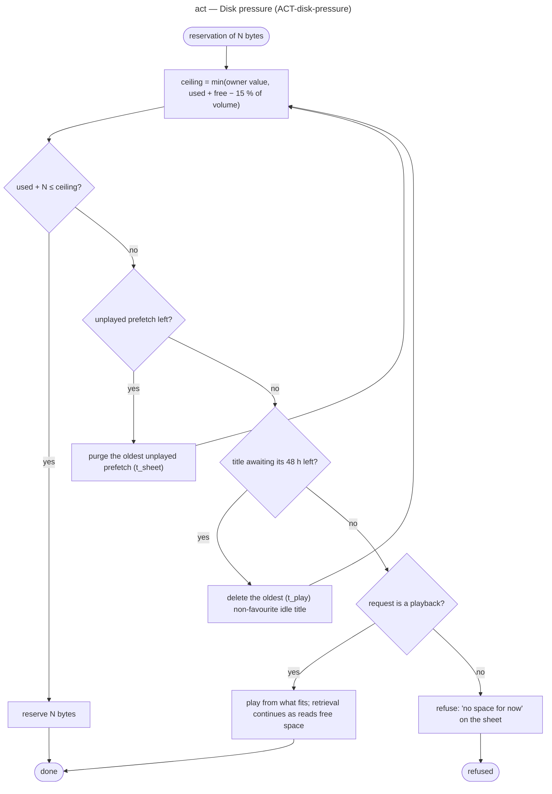

# Activity diagram — on-demand retrieval — disk pressure

> **Feature**: UC40, UC42 (ACT-disk-pressure)
> **Requirements**: REQ-53
> **Related ADRs**: ADR-0044

Runs before every reservation (prefetch, rest of the file, favourite third).

## Diagram

## Rules

- Never evicted: titles being played (a lease), favourite thirds, files under `MEDIA_ROOT`.
- A prefetch is never evicted to make room for another prefetch of lower or equal priority if it
  was opened in the last 5 min (prevents two open sheets from evicting each other).
- Every eviction is logged with its reason (`retrieval.evicted`, ADR-0021) and counted in the
  statistics (space saved).
