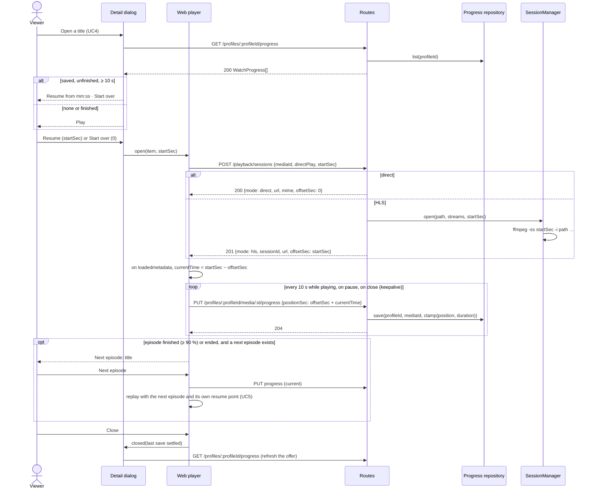

# Sequence diagram — playback — resume a title and play the next episode

> **Feature**: UC6 Resume a title, UC7 Play the next episode —
> [use cases](01-use-case.md), [spec](../../specs/resume-playback.md)
> **Related ADRs**: ADR-0006, ADR-0007

## Context

Resume adds a start offset to the UC5 flow ([sequence](02-sequence-watch-a-title.md))
and a periodic position save. Only the differences are drawn; the session lifecycle is
unchanged.

## Diagram

## Notes

- `offsetSec` makes the saved position absolute whatever the mode: direct play seeks in
  the file, HLS starts FFmpeg at the offset (EVENT playlist, no seek-ahead — ADR-0006).
- HLS input seeking lands on the previous keyframe: the resume may start a few seconds
  early (spec 4a).
- `nextEpisode` and `isFinished` are pure; no autoplay countdown (ADR-0007 §4).
