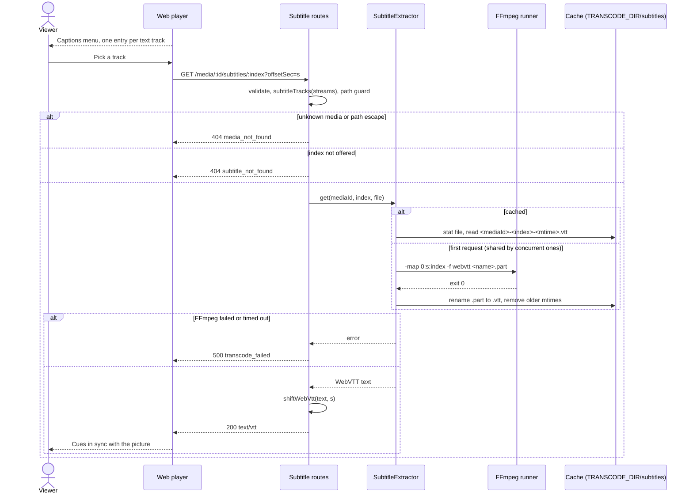

# Sequence diagram — playback — turn on subtitles

> **Feature**: UC10 Turn on subtitles — [use cases](01-use-case.md),
> [spec](../../specs/subtitles.md)
> **Related ADRs**: ADR-0006, ADR-0007, ADR-0009

## Context

Subtitles ride on the UC5 flow ([sequence](02-sequence-watch-a-title.md)): the player is
already playing, directly or through HLS. Only the track request is drawn.

## Diagram

## Notes

- `s` is the session's `offsetSec`: 0 in direct play, the resume point in HLS.
- The cache keeps the unshifted track, so one extraction serves every offset.
