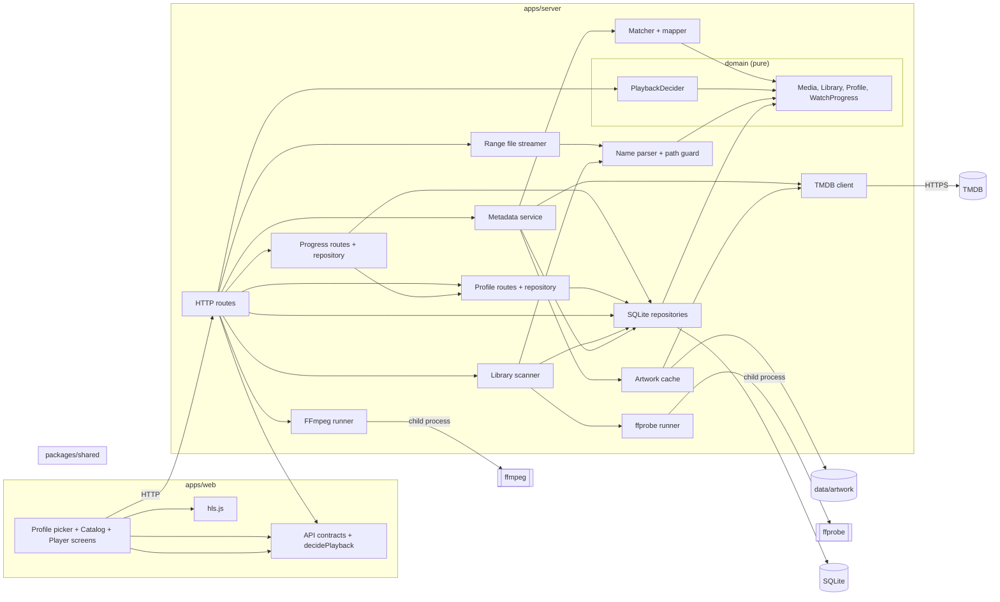

# Component diagram — playback — system structure

> **Feature**: MVP v0.1.0
> **Related ADRs**: ADR-0001

## Context

How the system is split and who depends on whom. The dependency rule holds: the domain
(decider, entities) imports nothing from Fastify, Drizzle, FFmpeg or the filesystem.

## Diagram

## Notes

- Flat layering on purpose: routes call the domain and the adapters directly. A ports
  layer appears only when a second implementation exists (e.g. a second metadata
  provider).
- The two runners are the only egress to the process API; nothing else spawns processes.
  The scanner receives the `ffprobe runner` as a function (`Prober`) so tests inject a
  fake. `Name parser + path guard` are pure (no fs, no process).
- Metadata (#4, ADR-0003): the `TMDB client` is the single HTTP egress, injected into
  the `Metadata service` as an interface (tests pass a fake; the real one receives
  `fetch`). `Matcher + mapper` are pure. The `Artwork cache` is the only writer under
  `data/artwork` and downloads through the client. The scanner never calls TMDB: the
  scan route composes `scan` then `enrich` (UC1's «include»), so a TMDB failure cannot
  fail a scan.
- Progress (#9, ADR-0007): `PUT /media/:id/progress` and `GET /progress` write and read
  `watch_progress` through its own Drizzle repository; `isFinished` is pure in
  `packages/shared`.
