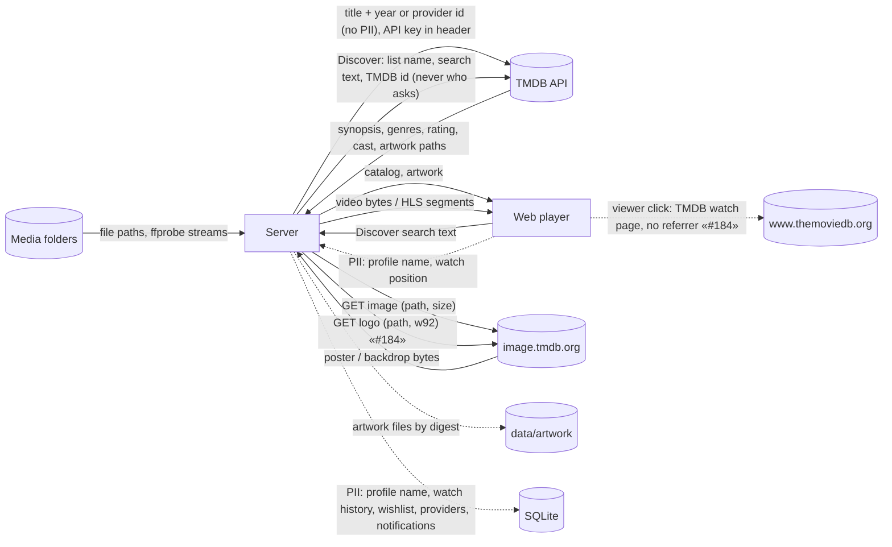

# Data-flow diagram — playback — what goes where

> **Feature**: MVP v0.1.0
> **Related ADRs**: ADR-0001, ADR-0003, ADR-0020

## Context

Which data crosses which boundary, with personal data flagged. The only PII in the MVP
is the profile name, the watch history, the wishlist (#127), the profile's providers and its notifications
(#277), and none leaves the server.

## Diagram

## Notes

- TMDB only ever receives a title and a year, a provider id read from the file name, a
  TMDB id or list name, or the text a viewer types in Discover search (#127), plus the owner's API key in the `Authorization` header, never who is watching.
  The key is never logged nor echoed in an error (ADR-0003). Image downloads go to
  `image.tmdb.org` only (the announced base URL is pinned to that host, no redirect).
- #184: opening a title sheet (Discover or library) asks TMDB the watch providers by TMDB
  id, at most once a day per title, never who asks; provider logos follow the poster path
  at `w92`. The browser reaches TMDB only when the viewer clicks an offer: a deliberate
  navigation to `www.themoviedb.org` in a new tab, `noopener noreferrer` (ADR-0029).
- Watch history stays in the local SQLite file; no telemetry, no cloud sync.
- Artwork is cached on disk under `data/artwork` (file name = SHA-256 of `size + path`)
  and served by the server (`GET /artwork/:file`): the web player never contacts
  TMDB by itself (an offer click, #184, is the viewer's own navigation), so no viewer IP leaves the home network. Discover posters follow the same path
  (`GET /discover/poster/:file`, only for paths the server handed out, ADR-0020). Cast photos are not cached in the MVP
  and therefore not shown (follow-up).
