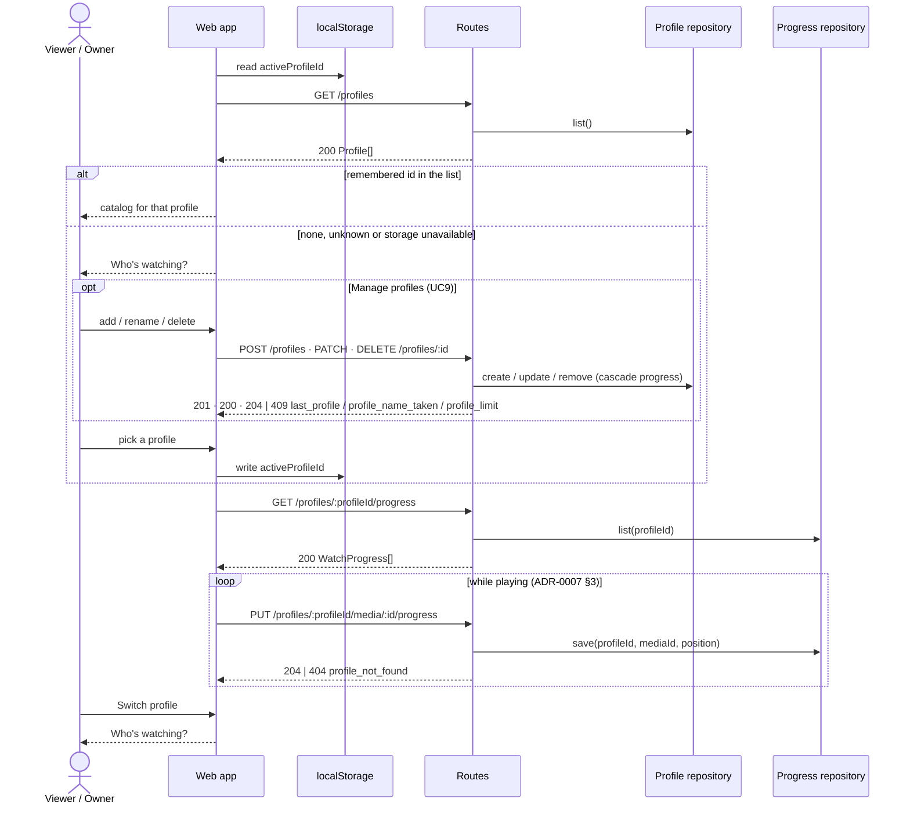

# Sequence diagram — profiles — pick and manage a profile

> **Feature**: UC8 Pick a profile, UC9 Manage profiles —
> [use cases](../playback/01-use-case.md), [spec](../../specs/profiles.md)
> **Related ADRs**: ADR-0007, ADR-0008

## Context

How the web settles on the active profile, how the owner manages profiles, and how the
active profile scopes progress. The playback session flow is unchanged.

## Diagram

## Notes

- `profile_not_found` while saving means the profile was deleted from another device:
  the save is dropped like any failed save, and the next start shows the picker.
- Profiles are a preference boundary, not a security one, until #18 (ADR-0008 §4).
